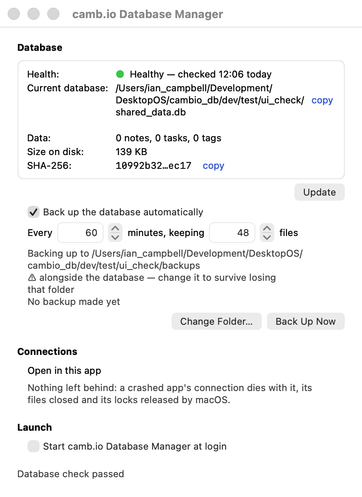

# camb.io Database Manager



camb.io Database Manager is the small menu bar app that owns the one SQLite file
the [Notes](../notes) and [Tasks](../tasks) apps share. It creates that
database when there is none, adopts it when there is, checks its
integrity at launch and daily, and makes the hourly verified backups.
Neither app does any of that any more: they open the file it looks after,
and say so if it is not there.

It replaces nothing of Apple's. It exists so that the database has one
keeper, whether or not Notes or Tasks happens to be running.

## Quickstart

**Prerequisites**

- macOS 14.0 (Sonoma) or later
- Xcode Command Line Tools: `xcode-select --install`
- MacPorts `sqlite3` and `pkgconf`: `sudo port install sqlite3 pkgconf`
  (the same SQLite Notes and Tasks link, so every process on the one file
  runs one SQLite)

**Clone and build.** The app compiles in the `shared_data` module (the
database itself) and two files of `shared_ui` (the tool panel and a few
AppKit helpers), so check the three repositories out beside each other:

```sh
git clone https://github.com/IANatCAMBIO/cambio_db.git cambio_db
git clone https://github.com/IANatCAMBIO/SharedData.git shared_data
git clone https://github.com/IANatCAMBIO/SharedUI.git shared_ui
cd cambio_db
make install
```

`make install` builds the bundle and copies it to
`~/Applications/camb.io_db_mgr.app` (per-user; no `sudo`). Re-running it
replaces the previous copy, stopping and restarting a running one.

| Command | What it does |
|---|---|
| `make` | build `camb.io_db_mgr.app` in the repo root |
| `make run` | build, then run the daemon on a sandbox database under `dev/data` |
| `make install` | build, then install to `~/Applications` |
| `make test` | release checks: a warning-free build, the core tests, the daemon's passes, and the window check |
| `make clean` | remove `build/` and the bundle |

See [BUILD.md](BUILD.md) for the toolchain, dependencies and test targets.

## First run

Launch `camb.io_db_mgr.app` from `~/Applications`. The coin appears in the
menu bar; there is no Dock icon and no window until you click it.

**The database.** On its first run the app looks for the shared database
at `~/Library/Application Support/camb.io/shared_data.db`. If one is
there — made by an earlier Notes or Tasks — it is adopted as it stands.
If none is, a complete, empty one is created there. Nothing is asked.
Install and start camb.io Database Manager **before** Notes or Tasks: each of
them now refuses to run until the database exists.

**What it does from then on.** At launch, and once a day, it runs
SQLite's integrity check against the file and tells you only if
something is wrong. Every minute it asks whether a backup is due under
the policy stored in the database (on by default: hourly, keeping the
newest 48) and makes one when it is: a verified copy under
`~/Library/Application Support/camb.io/backups/`, or a folder you choose.

**Start at login.** A keeper that is not running makes no backups. The
window's **Launch** section (or System Settings ▸ General ▸ Login Items)
registers the app as a login item. macOS may ask you to allow it the
first time.

**Code signing.** The build signs with your first "Apple Development"
certificate if you have one, else ad hoc. Nothing here needs a privacy
grant, so either works.

**One copy per database.** A second copy started on the same file quits
with a notice: a lock file beside the database says who has it.

## Uninstalling

Everything is reversible.

1. Open the window from the coin and turn off **Start at login**, or
   remove camb.io Database Manager under System Settings ▸ General ▸ Login Items.
2. Quit it from the coin's menu (right-click or ⌃-click ▸ Quit).
3. Delete `~/Applications/camb.io_db_mgr.app`.

The database, its backups and the lock file stay in
`~/Library/Application Support/camb.io/`; Notes and Tasks keep using the
database. Delete that folder only if you mean to lose every note and task.

## Features

- **One keeper for the shared file** — creates the database Notes and
  Tasks share when there is none, adopts it when there is, and holds the
  only lock on being its keeper.
- **Integrity checked without being asked** — `PRAGMA integrity_check` and
  `PRAGMA foreign_key_check`, plus the cross-table rules the two apps rely
  on, at launch and daily; **Update** runs them now. A problem is shown
  the moment it is found.
- **Hourly verified backups** — `VACUUM INTO` copies, verified before they
  count, named in UTC, the oldest removed only after a new one is good;
  the policy lives in the database itself.
- **A fingerprint on demand** — the file's size and SHA-256 as it stands,
  copyable, comparable with `shasum -a 256` or with a backup.
- **Who has the database open** — every process holding the file, by
  name and pid, and a plain account of what a crash can leave behind
  (nothing that is a connection: log content, a backup claim, an
  unfinished backup folder).
- **A window, not a Settings tab** — everything the Database section of
  the two apps' Settings used to show, under the coin.

The full reference is in [USER_GUIDE.md](USER_GUIDE.md).

## License

BSD 3-Clause. See [LICENSE](LICENSE).
